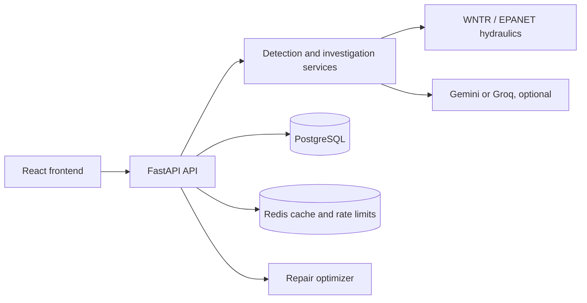

# AquaTrace System Explanation

## 1. Purpose and product idea

AquaTrace is a backend and web console for water-leak investigation. The product starts with a pipe-network model and a small set of pressure observations. It estimates which junctions are most worth inspecting, explains the next action, records crew feedback, and prioritizes repairs.

The central design rule is **separate evidence from truth**. The detector and investigation agent work only with observations and public network data. The hidden simulated leak is stored privately and is available only through the explicit demo evaluation route.

## 2. High-level architecture

The main repository areas are:

| Area | Responsibility |
|---|---|
| `backend/app` | FastAPI routes, DTOs, services, persistence, security boundaries |
| `backend/data/Net3.inp` | Benchmark EPANET network |
| `backend/alembic` | Database migrations |
| `backend/docs` | Backend contracts and operating rules |
| `frontend/src` | React console and backend adapter |
| `docker-compose.yml` | Local PostgreSQL, Redis, migration job, and API |

## 3. Complete request flow

### Step 1: startup and readiness

Docker starts PostgreSQL and Redis first. The migration job creates or updates tables. The API loads the network and builds hydraulic signatures in the background. `/health` reports database and Redis status plus signature progress; `/ready` is used when the service is ready for normal traffic.

### Step 2: load the network

`GET /network` returns nodes, pipes, coordinates, elevations, lengths, diameters, and topology needed by the map. The response contains public network information only.

### Step 3: create a scenario

`POST /scenario/leak` accepts a seed, leak size, noise level, and sensor selection. WNTR runs the no-leak and leak hydraulic states. The service applies controlled demand variation, sensor noise, and optional dropout, then stores the public observations. The private leak node and parameters are stored separately.

### Step 4: detect candidates

`POST /detect` compares observed pressure with the expected baseline. It uses cached hydraulic signatures, removes a common demand component, fits non-negative candidate effects, and calculates relative scores. A Gaussian noise-floor guard can return an abstention when the evidence is not strong enough. The endpoint never returns the hidden truth.

### Step 5: investigate

`POST /agent/step` provides a bounded investigator turn. The available tools are:

1. `rank_candidates`: sort likely junctions from current evidence;
2. `simulate_hypothesis`: compare a candidate leak simulation;
3. `plan_inspection`: turn candidates into a short crew route;
4. `recommend_sensor_addition`: suggest a sensor that can separate candidates.

The configured Gemini or Groq client receives sanitized context and a strict tool contract. If no provider is configured or a provider fails, a scripted fallback uses the same tools.

### Step 6: record field feedback

`POST /field/result` records a crew observation such as found, not found, or inaccessible. PostgreSQL locks the scenario row and checks its revision. A stale revision returns a conflict rather than overwriting newer evidence. Repeating the same idempotency key is safe.

### Step 7: reveal for evaluation

`GET /scenario/{scenario_id}/reveal` is the only route that exposes the hidden simulated answer. It exists so a demo or evaluator can measure rank and hop error. The detector, investigation agent, logs, and LLM providers do not use this route.

### Step 8: optimize repairs

`POST /repair/optimize` uses confirmed field results and repair assumptions to select a plan under a budget. It computes an exact sparse solution and shows a greedy comparison, expected water/value assumptions, and payback information.

## 4. What the detector is doing

1. The hydraulic model calculates expected pressures.
2. Candidate signatures describe how each possible leak would change sensor pressures.
3. The observed-minus-expected difference is the **residual**.
4. Demand projection removes a broad pressure change shared across the network.
5. A non-negative fit prevents a candidate from cancelling another candidate with an impossible negative leak.
6. Scores are normalized for ranking and labelled relative.
7. The noise-floor guard checks whether the separation is large enough to justify a call.

This is a useful operational ranking, not a statistical guarantee that the top candidate is correct.

## 5. AI safety and data boundaries

The model is an optional explanation and planning component. It is not the source of hydraulic truth.

- Prompt text is delimited and sanitized.
- User-controlled text cannot replace the system purpose or tool rules.
- Only allowlisted tools can be requested.
- Pydantic DTOs validate tool arguments and outputs.
- The model receives bounded public observations, not the private truth table.
- Provider text is not treated as authoritative state.
- Gemini and Groq are attempted through a failover client; the scripted fallback works offline.
- Rate limits and body-size limits protect expensive routes.

Authentication is excluded from the current scope, so the deployed service still needs an identity and authorization layer before production exposure.

## 6. Technical terms in plain English

| Term | Meaning and reason for use |
|---|---|
| API | A documented way for the frontend to call backend functions. |
| FastAPI | Python web framework that gives typed routes and OpenAPI documentation. |
| DTO (Data Transfer Object) | A typed request or response shape; it rejects malformed data at the boundary. |
| PostgreSQL | Durable relational database for scenarios, observations, reports, and repairs. |
| SQLAlchemy | Python database toolkit used to keep persistence code modular. |
| Alembic | Migration tool that changes database schema in a repeatable way. |
| Redis | Fast in-memory store used for caching and shared rate limits. |
| Token bucket | A quota algorithm that allows bursts while enforcing a long-term request rate. |
| Lua script | An atomic Redis script so concurrent API workers update one quota safely. |
| WNTR | Water Network Tool for Resilience; it runs water-network hydraulic calculations. |
| EPANET `.inp` | Text format describing nodes, pipes, pumps, demands, and other network model data. |
| Hydraulic signature | The expected sensor-change pattern for a candidate leak. |
| Residual | Observed pressure minus expected pressure. |
| PDD | Pressure-dependent demand: demand changes when pressure changes. |
| LLM | Large Language Model; used here for bounded planning language, not physics. |
| Prompt injection / hijacking | Untrusted text trying to make the model ignore its purpose or reveal data. |
| UUID | A globally unique identifier used for scenarios and reports. |
| JSON | The structured format used in HTTP request and response bodies. |
| JSONB | PostgreSQL's indexed JSON storage, useful for flexible observations and tool traces. |
| CAS | Compare-and-swap; update only if the stored revision still matches the client's revision. |
| CORS | Browser permission rules controlling which frontend origins may call the API. |
| Docker Compose | A repeatable local definition for the API, database, and Redis services. |
| Supabase | A hosted PostgreSQL platform; the schema is kept portable so migration is possible later. |
| PKR | Pakistani rupees, used for current repair-cost assumptions. |

## 7. Why these technologies fit this product

- **Python** fits WNTR and scientific data processing.
- **FastAPI and Pydantic** make the frontend contract explicit and generate interactive API docs.
- **PostgreSQL** handles transactions, JSONB observations, private/public schema separation, and future hosted PostgreSQL migration.
- **Redis** avoids recalculating signatures on every request and gives all API workers one rate-limit view.
- **Docker Compose** gives every teammate the same PostgreSQL, Redis, and API setup.
- **React/Vite** provides a fast interactive console; Deck.gl and D3 render the network and evidence views.

## 8. Deployment and configuration

Copy the backend environment template to `.env` and set database, Redis, CORS, rate-limit, and optional LLM values. Never commit real keys. Run `docker compose up --build` from the backend deployment directory. The API, migration job, PostgreSQL, and Redis then share the Compose network.

For a hosted move, point the database URL at a managed PostgreSQL/Supabase instance, keep migrations as the schema source of truth, use a managed Redis, and place the API behind HTTPS and authentication.

## 9. Current evidence and limits

The current implementation has passed the focused backend suite (66 tests), the frontend suite (33 tests), Docker startup/migrations, and the live backend verification path. The simulation diagnostics are useful engineering evidence, but they are not field accuracy.

Current limits are one hidden leak per scenario, steady-state snapshots, junction-level candidates, synthetic demand/noise, benchmark `Net3.inp` data, assumed repair costs, and no live utility SCADA/GIS ingestion. Sensor-placement routes and field inspection workflows beyond the implemented field-result route remain future integration work.

## 10. Production roadmap

1. Import and calibrate a utility's EPANET/GIS model.
2. Connect authenticated SCADA or historian readings.
3. Add authentication, authorization, audit logs, and secret management.
4. Validate against historical leak incidents and measure operational cost.
5. Support multiple simultaneous leaks and time-series transients.
6. Complete sensor-placement and field-inspection integrations.
7. Add observability, alerting, backups, and a managed deployment.
